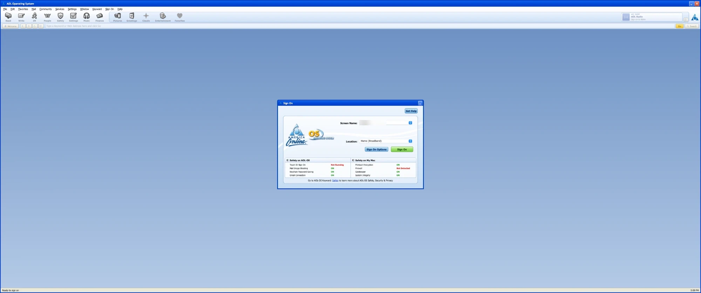
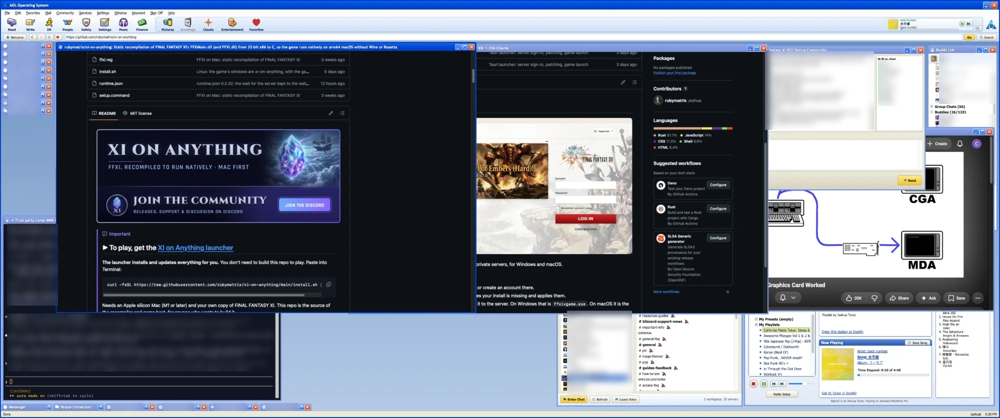

# AOL-OS

AOL-OS is a full-screen macOS shell styled after America Online 9.0. Mail,
chat, music, pictures and the web open as windows inside one AOL frame, with
AOL-style sign on, toolbar and sounds.

| Sign On | Desktop |
| --- | --- |
|  |  |

## Docs

<table>
  <tr>
    <th align="left">Use</th>
    <th align="left">Set up</th>
    <th align="left">Contribute</th>
  </tr>
  <tr>
    <td valign="top">
      <a href="docs/usage.md"><b>Usage</b></a> 
      Run, services, windows, Buddy List, Chat Rooms
    </td>
    <td valign="top">
      <a href="docs/gmail.md"><b>Gmail</b></a> 
      OAuth for Read and Write Mail  
      <a href="docs/slack.md"><b>Slack</b></a> 
      User token for the Buddy List and Chat Rooms  
      <a href="docs/spotify.md"><b>AOL Radio</b></a> 
      Spotify app ID for the native player
    </td>
    <td valign="top">
      <a href="CONTRIBUTING.md"><b>Contributing</b></a> 
      Branches and pull requests  
      <a href="docs/style-guide.md"><b>Style guide</b></a> 
      Swift, AppKit and WebKit conventions  
      <a href="docs/testing.md"><b>Testing</b></a> 
      Build and test before every pull request  
      <a href="docs/evidence.md"><b>Evidence</b></a> 
      Sources that back a claim about behavior  
      <a href="docs/ai/README.md"><b>AI contributions</b></a> 
      Policy for AI-assisted work
    </td>
  </tr>
</table>
